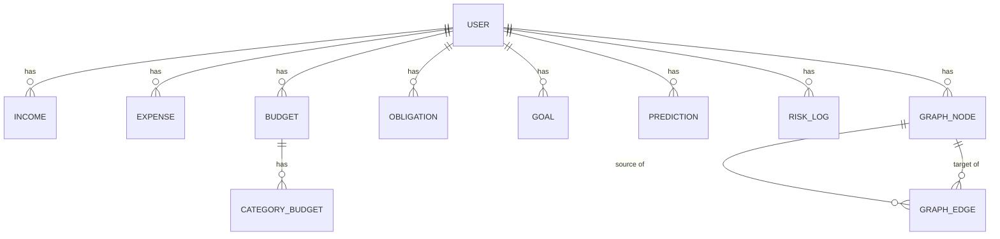

# 🗄️ WealthMap — Database Module Handoff

**Owner:** Database module
**Hands off to:** Backend developer (Express + engines)
**Files in this handoff:** `server/prisma/schema.prisma`, `server/prisma/seed.ts`, `server/.env.example`, this doc.

---

## 1. What this covers

The full Prisma schema for all 11 tables named in the project README, built for MySQL 8, with:

- Relations wired for every engine that needs to read across tables (Financial State, Forecasting, Risk, Dependency Graph, What-If, Health Score)
- Indexes on every `userId` and on the date/category columns the engines will filter or sort by
- A seed script that creates one demo user with income, expenses, a budget, obligations, a goal, a risk log, a prediction, and a small dependency graph — so you can start building the engine endpoints against real rows on day one, before the frontend or auth flows exist.

## 2. Entity-Relationship Diagram



## 3. Table-by-table notes

| Table | Key design decisions |
|---|---|
| `users` | `cashBalance` / `savingsBalance` / `emergencyFundBalance` live here as the running totals the Financial State Engine reads first. `declaredMonthlyIncome` stores the user's self-reported income for quick access without summing all income rows. `currency` defaults to `INR`. |
| `incomes` | `frequency` enum drives the forecasting engine's recurrence math. |
| `expenses` | `paymentMethod` enum and `isRecurring` boolean added for recurring-expense detection and anomaly analysis. Indexed on `(userId, spentAt)`, `(userId, category)`, and `(userId, isRecurring)` — the three access patterns the forecasting, anomaly-detection, and subscription engines need. |
| `budgets` | One row per user per `(month, year)` — enforced by a unique constraint, so "upsert this month's budget" is a single safe query. |
| `category_budgets` | Child of `budgets`; unique on `(budgetId, category)` so a category can't be double-defined in the same month. |
| `obligations` | `dueDate` + `frequency` + `isRecurring` together are enough for the risk engine to project the next N occurrences without a separate recurrence table. |
| `goals` | `status` enum lets the frontend filter active vs completed goals without deleting history. |
| `predictions` | Stores each engine run as `resultJson` (a JSON column) rather than one column per possible output shape — the forecast, cash-flow projection, and risk-date predictions all have different shapes. Query by `(userId, type)` and take the latest `generatedAt`. |
| `risk_logs` | Stores the five weighted components (`budgetRisk`, `cashFlowRisk`, `obligationRisk`, `velocityRisk`, `goalRisk`) alongside the final `riskScore`, so the health-score explainability requirement ("why is my risk high") never needs to recompute from scratch. |
| `graph_nodes` / `graph_edges` | Matches the React Flow data model directly — `positionX`/`positionY` are stored so the frontend graph layout is stable across reloads. Edges carry `weight` + `severity` for the BFS propagation described in the architecture doc. |

## 4. Setup steps (run these in `server/`)

1. Copy this schema and seed file into your existing `server/prisma/` folder (see repo tree below).
2. Add the database script/config block to your `server/package.json` (see §5).
3. Install dependencies:
   ```bash
   npm install prisma @prisma/client
   npm install -D ts-node typescript @types/node
   ```
4. Copy `.env.example` to `.env` and fill in a real `DATABASE_URL` pointing at your local or shared MySQL 8 instance.
5. Create the database if it doesn't exist yet:
   ```bash
   mysql -u root -p -e "CREATE DATABASE wealthmap;"
   ```
6. Run the first migration (this both creates the migration SQL and applies it):
   ```bash
   npx prisma migrate dev --name init
   ```
7. Generate the typed client (also runs automatically after `migrate dev`, but explicit is cheap):
   ```bash
   npx prisma generate
   ```
8. Seed demo data:
   ```bash
   npx prisma db seed
   ```
9. Sanity check:
   ```bash
   npx prisma studio
   ```
   You should see the demo user, their expenses, and a small dependency graph.

## 5. Required `package.json` additions

Add this block so `npx prisma db seed` knows what to run:

```json
{
  "prisma": {
    "seed": "ts-node prisma/seed.ts"
  }
}
```

And make sure these are in `devDependencies`: `prisma`, `ts-node`, `typescript`, `@types/node`. `@prisma/client` should be in regular `dependencies` since the engines import it at runtime.

## 6. How the engines should use this

- Every engine module (`server/src/modules/engines/*`) should import a single shared `PrismaClient` instance (create it once in e.g. `server/src/utils/prisma.ts`, not per-request) and read the current state via the `User` row plus its relations.
- The **Financial State Engine** is the only module that should assemble the full "digital twin" object described in `ARCHITECTURE.md` — other engines should call into it rather than querying all 11 tables themselves, to keep the data path in one place.
- The **What-If Simulator** should never write to the real tables — clone the plain JS object returned by the Financial State Engine, apply the hypothetical delta in memory, and re-run the pure calculation functions against the clone. Nothing in `prisma/schema.prisma` needs a "draft" or "simulation" table for this.
- Store every completed forecast/risk run (`predictions`, `risk_logs`) so the frontend can show trend-over-time charts without recomputing history.

## 7. Known limitations / things to confirm with the team

- IDs are UUID strings (`@default(uuid())`), not auto-increment ints — confirm this matches what the frontend / auth module expects for route params.
- `Decimal` fields come back from Prisma as `Decimal.js` objects, not plain JS numbers — the AI layer's "build a financial context summary string" step should call `.toString()` or `.toNumber()` explicitly before templating them into the LLM prompt.
- No `sessions`/`refresh_tokens` table is included — the README only specifies JWT auth, which is stateless by default. Add one if you introduce refresh-token rotation.
- Multi-currency is not implemented beyond the single `currency` field on `users` — all amounts across every table are assumed to be in that one currency.
- The seed password hash is for `Demo@1234` (bcrypt rounds 12). Use this only for local dev testing — never deploy seed data to production.

---

## Repo placement

```
WealthMap/
└── server/
    ├── prisma/
    │   ├── schema.prisma      ← this handoff
    │   ├── seed.ts            ← this handoff
    │   └── migrations/        ← generated locally by `npx prisma migrate dev`, then commit it
    ├── docs/
    │   └── DATABASE.md        ← this handoff
    └── .env.example           ← this handoff (merge with any existing one)
```
